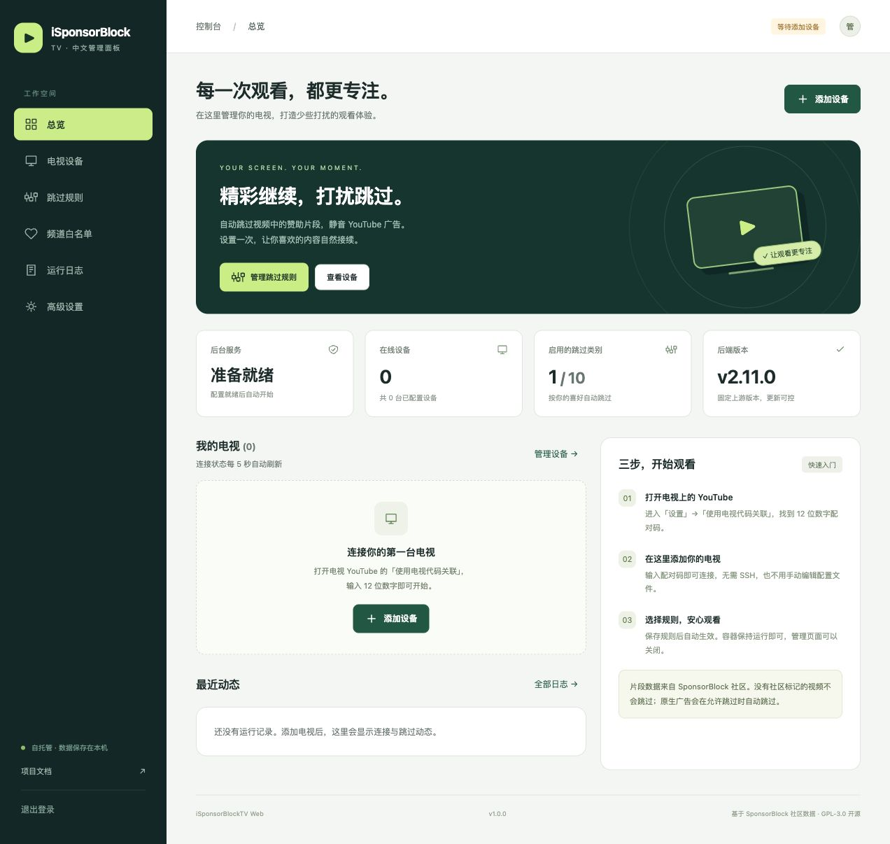
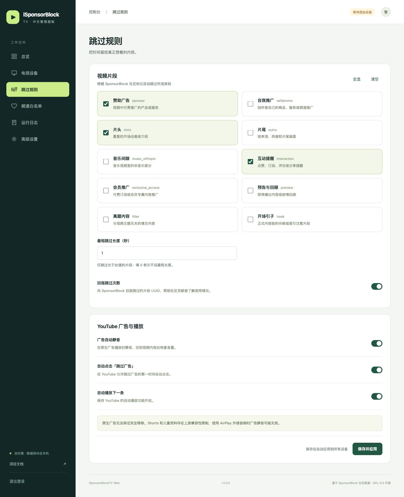

<div align="center">

# iSponsorBlockTV Web

**用中文网页管理电视上的 YouTube，部署只需一个容器。**

[](https://github.com/dongbo501/isponsorblocktv-web/actions/workflows/publish.yml)
[](LICENSE)
[](https://github.com/dongbo501/isponsorblocktv-web/pkgs/container/isponsorblocktv-web)

[快速部署](#快速部署) · [首次使用](#首次使用) · [代理设置](#代理设置) · [更新教程](#更新镜像) · [常见问题](#常见问题)

</div>

基于 [dmunozv04/iSponsorBlockTV](https://github.com/dmunozv04/iSponsorBlockTV)，将原本需要终端或配置文件完成的操作放进中文 Web 面板。**不需要 `.env`，不需要预先创建或编辑 `config.json`**；日常配置全部在浏览器内完成。

镜像：`ghcr.io/dongbo501/isponsorblocktv-web:latest`

支持：`linux/amd64`（大部分 x86 NAS / 服务器）和 `linux/arm64`（ARM64 NAS / 树莓派 64 位系统）。



> 本项目并不能让所有 YouTube 广告凭空消失。SponsorBlock 负责跳过社区标记的视频片段；YouTube 原生广告可以自动静音，并在出现「跳过广告」按钮时自动跳过。不可跳过的广告仍需要等待。功能和兼容性受 YouTube 与上游项目影响。

## 功能

| 功能 | 网页面板中的位置 |
|---|---|
| 多电视管理、12 位电视代码配对、手动 Screen ID 添加 | 电视设备 |
| DIAL / SSDP 与 Chromecast / mDNS 局域网发现 | 电视设备 → 局域网搜索 |
| 设备重命名、时间偏移、凭据查看与修改、移除 | 电视设备 → 编辑 |
| 10 类 SponsorBlock 自动跳过、最短片段长度 | 跳过规则 |
| YouTube 广告自动静音与自动点击跳过 | 跳过规则 |
| 自动播放下一条、向 SponsorBlock 回报跳过次数 | 跳过规则 |
| 频道白名单、频道搜索与手动添加 | 频道白名单 |
| YouTube API 密钥、自定义 SponsorBlock 接口、客户端名称 | 高级设置 |
| HTTP(S) 代理地址与开关 | 高级设置 |
| 启动、暂停、重启，异常退出后自动重试 | 高级设置 / 总览 |
| 实际连接状态、播放状态、实时日志与导出 | 总览 / 运行日志 |
| 调试日志、去除敏感正文的 HTTP 诊断 | 高级设置 |
| 兼容原版 v2 的配置导入导出 | 高级设置 → 备份与恢复 |
| 首次设置密码、登录、修改密码、手机适配 | 全站 |

当前固定上游版本 **v2.11.0**，提交 [`005d248d20dd529bd3e8dca4d17a65ab05135ce8`](https://github.com/dmunozv04/iSponsorBlockTV/commit/005d248d20dd529bd3e8dca4d17a65ab05135ce8)。上游源码原样保存在 `vendor/upstream/`，不会在容器启动时在线下载或自动替换。

## 快速部署

准备一台运行 Docker 的 NAS、Linux 服务器或其他设备。容器需要能访问 YouTube 和 SponsorBlock；如果直连不可用，可在网页内设置代理。下面两种部署方式任选一种，不要同时运行。

### 方式一：Docker Run

```bash
docker run -d \
  --name isponsorblocktv-web \
  --restart unless-stopped \
  -p 8080:8080 \
  -v isponsorblocktv-web-data:/data \
  --security-opt no-new-privileges:true \
  --cap-drop ALL \
  ghcr.io/dongbo501/isponsorblocktv-web:latest
```

浏览器打开：

```text
http://你的NAS或服务器IP:8080
```

例如：`http://192.168.1.10:8080`。端口冲突时，将命令改为 `-p 18080:8080`，再访问 `http://服务器IP:18080`。右侧容器端口保持 `8080`。

### 方式二：Docker Compose（推荐）

新建一个目录，创建 `compose.yaml`，内容如下。**只需要这一个文件，没有 `.env` 文件。**

```yaml
services:
  isponsorblocktv-web:
    image: ghcr.io/dongbo501/isponsorblocktv-web:latest
    container_name: isponsorblocktv-web
    restart: unless-stopped
    ports:
      - "8080:8080"
    volumes:
      - isponsorblocktv-data:/data
    security_opt:
      - no-new-privileges:true
    cap_drop:
      - ALL
    logging:
      driver: json-file
      options:
        max-size: "10m"
        max-file: "3"

volumes:
  isponsorblocktv-data:
    name: isponsorblocktv-web-data
```

在该目录运行：

```bash
docker compose up -d
```

也可以直接下载本仓库提供的配置：

```bash
mkdir -p isponsorblocktv-web
cd isponsorblocktv-web
curl -fsSLO https://raw.githubusercontent.com/dongbo501/isponsorblocktv-web/main/compose.yaml
docker compose up -d
```

### 群晖、威联通、飞牛等 NAS

在容器管理界面创建项目，粘贴上面的 Compose 内容即可。或者手动创建容器：镜像填 `ghcr.io/dongbo501/isponsorblocktv-web:latest`，映射容器端口 `8080`，将一个**持久化数据卷**挂载到 `/data`，启用自动重启。

推荐使用 Docker 命名卷。若改用宿主机目录，例如 `./data:/data`，目录必须允许 **UID/GID 1000:1000** 读写；权限不正确会导致容器无法启动。无需使用特权模式，不需要挂载 Docker Socket。

## 首次使用

1. 在可信任的局域网内打开面板，设置至少 **10 个字符**的管理密码。没有默认密码；先完成设置，再考虑配置远程访问。
2. 在电视上打开 YouTube → **设置 → 使用电视代码关联**（部分版本叫「通过电视代码关联」）。屏幕会显示 **12 位数字**。
3. 在网页点击 **添加设备 → 电视配对码**，输入数字，可选填「客厅电视」等名称，点击 **配对并添加**。
4. 进入 **跳过规则**，选择希望跳过的类别，点击 **保存并应用**。
5. 保持容器运行，正常在电视上观看 YouTube。**管理页面可以关闭**，无需安装电视端插件。

配对码可以包含空格或短横线。它不是 Google 登录验证码，也不是 YouTube 登录页面的字母代码。

默认启用赞助片段跳过、原生广告静音、自动点击跳过广告、自动播放和跳过次数回报；默认最短跳过长度为 1 秒。

### 设备状态和时间偏移

- **已连接 / 正在播放**：来自上游实际连接与播放状态，每 5 秒刷新。
- **等待电视上线**：请打开该电视上的 YouTube。电视关机或退出应用时等待是正常现象。
- **服务运行中**：后台进程在运行，**不代表所有电视都已连接**。请同时看设备卡片。
- **等待添加设备**：还没有配置电视，管理面板正常运行。
- **服务已暂停**：所有设备的自动操作都已停止；到高级设置启动即可。暂停状态在容器重启后仍会保留。
- **时间偏移**以毫秒为单位，正值提前跳过、负值延后跳过，通常保持 0。

## 跳过规则

| 分类 | 含义 |
|---|---|
| 赞助广告 `sponsor` | 视频中付费推广的产品或服务 |
| 自我推广 `selfpromo` | 创作者的商品、服务或频道推广 |
| 片头 `intro` | 重复开场动画或介绍 |
| 片尾 `outro` | 结束语、鸣谢和片尾画面 |
| 音乐间隙 `music_offtopic` | 音乐视频里的非音乐部分 |
| 互动提醒 `interaction` | 点赞、订阅、评论、分享提醒 |
| 会员推广 `exclusive_access` | 付费订阅或会员专属内容推广 |
| 预告与回顾 `preview` | 即将播出内容或前情回顾 |
| 离题内容 `filler` | 与主题无关的填充内容 |
| 开场引子 `hook` | 正式内容前的问候或引子 |

最短跳过长度为 0 时不限制长度；其他数值仅跳过**长于**该数值的片段。清空所有分类并保存后，会关闭 SponsorBlock 片段跳过，广告静音与自动点击跳过仍独立生效。

「回报跳过次数」会向 SponsorBlock 发送所跳过片段的 UUID。可在面板关闭。

<details>
<summary>查看规则页面截图</summary>



</details>

## 代理设置

**全部在网页完成，无需 `.env` 或容器环境变量。**

1. 打开 **高级设置 → 代理与诊断**。
2. 在「HTTP(S) 代理地址」填写地址，例如：`http://192.168.1.10:7890`。
3. 点击 **保存代理与诊断**。
4. 在同页「连接与接口」打开 **通过代理访问网络**，点击 **保存连接设置**。
5. 回到设备页配对，或查看日志确认连接情况。

支持带用户名密码的 HTTP(S) 代理 URL。SOCKS 地址不受支持；如果代理软件提供混合端口，请使用其 HTTP 地址。局域网 IP、回环地址和 `.local` 设备发现请求保持直连。

Docker 普通桥接模式中，`127.0.0.1` 指向**容器自身**，不是 NAS。请填写代理设备的局域网 IP，并在代理软件中允许局域网连接。Linux host 网络模式下，容器共享宿主机网络，此时本机代理可以用 `127.0.0.1`。

代理凭据保存在 `/data/panel.json`，不要公开数据卷或备份。

## 局域网自动发现

电视配对码方式不要求电视与容器处于同一局域网，通常最方便。自动发现则依赖 SSDP/mDNS 多播，Docker 普通端口映射、跨 VLAN、访客 Wi-Fi 或路由器 AP 隔离可能阻止发现。

Linux 主机可使用仓库中的独立配置文件：

```bash
curl -fsSLO https://raw.githubusercontent.com/dongbo501/isponsorblocktv-web/main/compose.host.yaml
docker compose -f compose.host.yaml up -d
```

或使用 Docker Run：

```bash
docker run -d \
  --name isponsorblocktv-web \
  --restart unless-stopped \
  --network host \
  -v isponsorblocktv-web-data:/data \
  --security-opt no-new-privileges:true \
  --cap-drop ALL \
  ghcr.io/dongbo501/isponsorblocktv-web:latest
```

host 模式不配置 `ports`，面板直接使用宿主机 `8080` 端口。`compose.host.yaml` 是完整替代文件，**不要和普通 Compose 文件叠加使用**。切换前停止并移除原容器，保留数据卷。

进入 **电视设备 → 局域网搜索**，点击开始搜索。默认采用被动发现，约 12 秒；可开启「主动唤起 YouTube」，最长约 35 秒，这可能在局域网电视上启动 YouTube 应用。发现后点击添加。

macOS / Windows 的 Docker 网络通常经过虚拟机；自动发现不保证可用，推荐电视配对码。

## 频道白名单

白名单需要 **YouTube Data API v3 密钥**：

1. 在 [Google Cloud Console](https://console.cloud.google.com/) 创建项目，启用 **YouTube Data API v3**。
2. 在「API 和服务 → 凭据」创建 API 密钥。建议将 API 限制为 YouTube Data API v3；若限制来源 IP，填写容器实际访问互联网的出口 IP。
3. 将密钥填入 **高级设置 → YouTube Data API v3 密钥**，保存。
4. 在 **频道白名单**搜索频道，或手动输入频道名称与 `UC` 开头的 24 位频道 ID。

`@用户名`、频道网址和视频 ID 不能直接作为频道 ID。搜索及白名单检查会使用 Google API 配额。

**白名单仅豁免 SponsorBlock 片段跳过，不豁免 YouTube 原生广告静音/跳过。**这与上游行为一致。没有 API 密钥时其他功能都能使用。

## 配置备份与迁移

### 网页导入导出

在 **高级设置 → 备份与恢复**导出 JSON，可迁移到另一台本项目实例，也兼容原版 iSponsorBlockTV v2。

- 导出包含电视 Screen ID、YouTube API 密钥、规则及频道白名单，请作为敏感文件保管。
- 不包含管理密码、代理地址、诊断选项或暂停状态。
- 导入前会验证字段，拒绝无效分类、重复设备、错误频道 ID 等。失败时保留原配置。
- 导入会覆盖当前后端配置，并在后台服务启用时自动应用。
- 原版 v2 的 `config.json` 可以直接导入。v1 的 `atvs` 格式已经失效，需要重新配对。

### 完整备份数据卷

`/data` 包含全部持久化数据：

| 文件 | 内容 |
|---|---|
| `config.json` | 原版兼容后端配置，包括电视凭据 |
| `panel.json` | 代理、调试及 HTTP 诊断设置 |
| `auth.json` | 管理密码的 scrypt 盐与哈希，不保存明文密码 |
| `service.json` | 启用/暂停状态 |
| `service.log` / `.1` / `.2` | 经过脱敏并轮转的日志 |

正常情况下无需手动修改这些文件。完整迁移可备份命名卷，例如：

```bash
docker stop isponsorblocktv-web
docker run --rm \
  -v isponsorblocktv-web-data:/data:ro \
  -v "$PWD":/backup \
  alpine:3.22 sh -c 'cd /data && tar czf /backup/isponsorblocktv-backup.tar.gz .'
docker start isponsorblocktv-web
```

恢复时先停掉旧容器，向**新卷**解压，避免覆盖现有备份：

```bash
docker volume create isponsorblocktv-web-restored
docker run --rm \
  -v isponsorblocktv-web-restored:/data \
  -v "$PWD":/backup:ro \
  alpine:3.22 sh -c 'cd /data && tar xzf /backup/isponsorblocktv-backup.tar.gz && chown -R 1000:1000 /data'
```

随后部署新容器，把 Docker Run 的卷名改为 `isponsorblocktv-web-restored`，或将 Compose 底部的 `name:` 改成该名称。确认恢复正常前保留旧数据卷。

## 更新镜像

本项目**不会自动追踪或自动安装上游新版本**。上游更新后，由维护者检查兼容性、更新固定源码并发布新镜像，你再手动拉取即可。

更新前建议导出配置或完整备份数据卷。

### Docker Compose

在原 Compose 文件所在目录运行：

```bash
docker compose pull
docker compose up -d
```

使用 host 文件则执行：

```bash
docker compose -f compose.host.yaml pull
docker compose -f compose.host.yaml up -d
```

### Docker Run

```bash
docker pull ghcr.io/dongbo501/isponsorblocktv-web:latest
docker stop isponsorblocktv-web
docker rm isponsorblocktv-web
```

然后重新执行最初的 `docker run` 命令，使用**相同的数据卷、网络和端口设置**。`docker rm` 不会删除这里使用的命名数据卷。

> 只执行 `docker restart` 不会切换到新镜像。不要执行 `docker compose down -v` 或删除数据卷，否则会丢失配置。

标签说明：`latest` 为当前发布版；`1.0.0` 等版本标签便于固定版本；`sha-…` 标签便于追溯代码。若新版本有问题，可把镜像标签改回此前使用的版本，再重新创建容器。

## 常见问题

### 页面打不开

检查 `docker ps`、端口映射、防火墙和 NAS IP。可访问 `http://服务器IP:8080/healthz` 查看 HTTP 健康检查，或运行：

```bash
docker logs --tail 100 isponsorblocktv-web
```

`healthz` 表示管理服务可用，并返回后台状态；电视离线并不会让容器健康检查失败。

### 配对失败 / 一直等待电视上线

- 使用电视 YouTube 的「使用电视代码关联」，不要使用登录验证码。
- 重新打开电视 YouTube，获取新代码后重试。
- 确认**容器**能够访问 YouTube，而不只是浏览器可以访问；必要时按上文设置代理。
- YouTube 正在撤销旧格式 Screen ID。以前能用而现在失联的设备可能需要重新配对，尤其是旧版 26 位 ID。
- 上游不支持 YouTube Kids 客户端/儿童资料，切换到普通 YouTube 资料。
- 检查高级设置中的后台服务是否被暂停。

### 服务运行中，为什么没跳过某个片段

服务进程在运行不等于电视已连接。先查看设备卡片，然后检查分类、最短长度和白名单。视频必须有 SponsorBlock 社区标记；不能保证所有广告/片头都有数据。需要排查时，临时开启详细日志，问题解决后关闭。

### 原生广告仍会出现 / Shorts 表现异常

本项目不会删除广告视频流。不可跳过广告只能静音等待，可跳过广告在 YouTube 允许时自动点击。Shorts 存在上游限制；Apple TV 经 AirPlay 输出到其他音响时，静音可能无效。完整兼容性参见 [上游说明](https://github.com/dmunozv04/iSponsorBlockTV#compatibility)。

### 频道搜索结果为空

确认已启用 YouTube Data API v3、密钥限制正确、配额足够、服务器可访问 Google API。也可手动填写真实频道 ID。

### 忘记管理密码

这是一项需要服务器访问权限的恢复操作，日常使用不需要。保持管理端口仅对可信网络开放，删除密码哈希文件后重启，再立即通过网页设置新密码：

```bash
docker exec isponsorblocktv-web python -c 'from pathlib import Path; Path("/data/auth.json").unlink(missing_ok=True)'
docker restart isponsorblocktv-web
```

电视配对和规则不会因此删除。重启后所有旧登录会话失效。

### 提示「配置已在另一页面更新」

面板会防止多个浏览器互相覆盖配置。保留需要的修改，刷新页面加载最新配置后重试。

### 可以公网访问吗

建议只在可信局域网或 VPN 内访问。若需要公网访问，先在本地完成密码设置，再使用 HTTPS 反向代理，并保留原请求 Host。面板内置密码哈希、HttpOnly / SameSite Cookie、CSRF 校验、登录频率限制和配置写入校验；同源部署即可，不需要额外前端服务或 CORS 配置。

### 多个容器能共用同一个数据卷吗

不能。本项目按**一个容器、一个 Web worker**运行，容器内可管理多台电视。多个实例共用数据会争抢配置和电视连接。要运行多个独立实例，请使用不同卷和端口。

## 开发与 API

Python 3.11+（镜像使用 Python 3.13），前端为无构建依赖的 HTML/CSS/JavaScript；一个容器包含 FastAPI 管理服务和独立的上游后台进程。

```bash
python3 -m venv .venv
. .venv/bin/activate
pip install -r requirements-dev.txt
DATA_DIR=./data python -m uvicorn webapp.app:app --host 127.0.0.1 --port 8080
```

上面的 `DATA_DIR` 仅供本地源码开发指定目录，容器部署无需设置任何环境变量。

```bash
ruff check webapp tests
pytest -q
node --check webapp/static/app.js
docker build -t isponsorblocktv-web:local .
```

API 设计、配置字段和调用示例见 [docs/API.md](docs/API.md)。登录后可访问 `/api/openapi.json` 获取完整 OpenAPI schema。所有管理 API 需要登录；修改操作还需要会话对应的 `X-CSRF-Token`。

测试覆盖认证、CSRF、限流、配置冲突与校验、持久化、配对协议适配、片段处理、代理路由、子进程崩溃重启及关闭。真实电视上的配对、发现、广告静音和跳过仍需结合实际设备与网络验证；自动测试不会伪造已连接设备或跳过统计。

维护者升级上游的方法见 [docs/MAINTENANCE.md](docs/MAINTENANCE.md)。推送主分支会运行测试并发布多架构 `latest` 镜像，创建 `v…` 标签会额外发布版本镜像；没有定时升级任务。

## 许可证与致谢

本项目遵循 [GNU GPL v3](LICENSE)。上游源码、版权声明及第三方许可说明保存在 `vendor/`，源码随仓库及镜像提供。我们新增中文界面、管理 API、进程管理、安全和容器发布配置，不修改固定版本的上游源码。

感谢 [dmunozv04/iSponsorBlockTV](https://github.com/dmunozv04/iSponsorBlockTV)、[SponsorBlock](https://sponsor.ajay.app/)、[pyytlounge](https://github.com/FabioGNR/pyytlounge) 及所有社区贡献者。本项目是独立社区扩展，与 YouTube / Google 无隶属关系。
